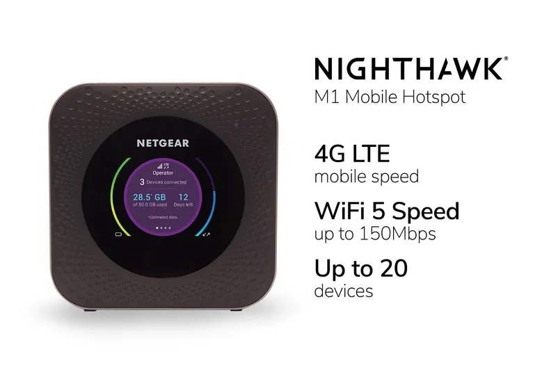

# Netgear Nighthawk M1 -- 4-Year RV Internet Lifeline, Ready for Your Adventures

## Work Log

## Status -- Resolved / Closed

- Sold 2026-11 for $35.
- Buyer found the package. Issue closed; no further action.

## 2026-11-02 -- eBay buyer message thread

- 3:33 PM (eBay time): buyer message

  > Good day. The packaged was not delivered. It was picked up at the post office. Can you say what is happening

- 4:33 PM (eBay time; 7:33 PM Eastern): my reply

  > Hi,
  >
  > Thanks for your message. I only know what I can find from the tracking info:
  >
  > > Your item was picked up at the post office at 12:43 pm on November 2, 2026 in FORT LAUDERDALE, FL 33351.
  >
  > Two things caught my attention:
  >
  > 1. "Picked up" versus "delivered"
  > 2. "Fort Lauderdale" versus "Sunrise"
  >
  > I researched #2 and found that ZIP code 33351 covers both cities, but #1 is still concerning. The additional annotations you provided in the address are unfamiliar to me. Could they have affected the routing or delivery?
  >
  > I'll check with USPS on my end and update you tomorrow morning. Could you also check on your end?
  >
  > Thanks,
  > Michael
  >
  > P.S. Tracking link: <https://tools.usps.com/tracking/9500115788976301078027>

- Tracking: USPS 9500115788976301078027
- Buyer's ship-to address (from my message) matches a Mulberry Logistics listing: 10498 NW 50th St, Sunrise, FL 33351, phone 754-223-2374 (LocalSearch listing, screenshot 2026-11-02). Other businesses are also located at this address, so the listing doesn't show who received the package. The "AGA103080-HP" line is unexplained.

## Plan

### Contacts

- Fort Lauderdale post office: 954-527-3245 (unverified; search result did not confirm it serves ZIP 33351; confirm on the USPS locator)
- Mulberry Logistics (listed at ship-to address; other businesses also at this address): 754-223-2374, 10498 NW 50th St, Sunrise, FL 33351
- USPS customer service: 1-800-ASK-USPS (800-275-8777)
- USPS online help request: usps.com (desktop recommended)

### Tuesday 2026-11-03

1. Visit the Fort Lauderdale post office in person when it opens; ask for the postmaster or supervisor.
2. Ask: who picked up the package, whether the record shows an ID or signature, whether a hold or redirect was on file, and whether the second address line changed routing.
3. Ask for a case number and the name of the person you spoke with.
4. If the in-person visit doesn't resolve it, submit the USPS online help request for tracking 9500115788976301078027.
5. Check eBay [Returns & Cases](https://www.ebay.com/sh/returns) for an open "item not received" case. Respond there with the tracking link and delivery details, and note the deadline on the case page.
6. If there's no case, check eBay messages for the buyer's reply. Answer only through eBay messages.
7. Don't send personal information or follow outside links.
8. Save screenshots of the case, the message thread, and the USPS tracking page.

### If the buyer says they didn't receive it

1. Wait 7 business days after the online help request, then submit a USPS Missing Mail search (usps.com/help/missing-mail.htm).
2. Keep all case numbers and dates in this log.

## The Story

We full-timed it in an RV for 4 years using this as our primary internet -- through remote National Forests, small towns, and everywhere in between. It was far more reliable than tethering to our phones. Now we have 5G iPhones and no longer need it. Rather than toss it, we'd love for someone to give it a second life. Priced to re-gift, not recycle.

## Specs

| Feature        | Details                              |
|----------------|--------------------------------------|
| **Model**      | Netgear Nighthawk M1 (MR1100)        |
| **Network**    | 4G LTE Category 16 (up to 1 Gbps)    |
| **WiFi**       | Dual-band 802.11ac (2.4 & 5 GHz)     |
| **Battery**    | 5040 mAh; 11 hours continuous        |
| **Dimensions** | 105.5 × 105.5 × 20.35 mm             |
| **Weight**     | 240 g                                |
| **LTE Bands**  | 1, 2, 3, 4, 5, 7, 12, 14, 29, 30, 66 |
| **Build Date** | January 2020                         |

## Condition

- Deactivated cleanly at AT&T store (10/12/2026)
- Fully functional, ready to reactivate with any compatible carrier
- Used condition with minor cosmetic wear from 4 years of travel
- No cracks or damage

## What's Included

- Device only

## Who Should Buy

- RV/vanlifers needing backup internet
- Remote workers in spotty WiFi areas
- Anyone wanting reliable mobile hotspot as a gift
- Budget-conscious buyers seeking quality used gear

---

*From a family of full-time RVers who believe in reuse over landfill.*
