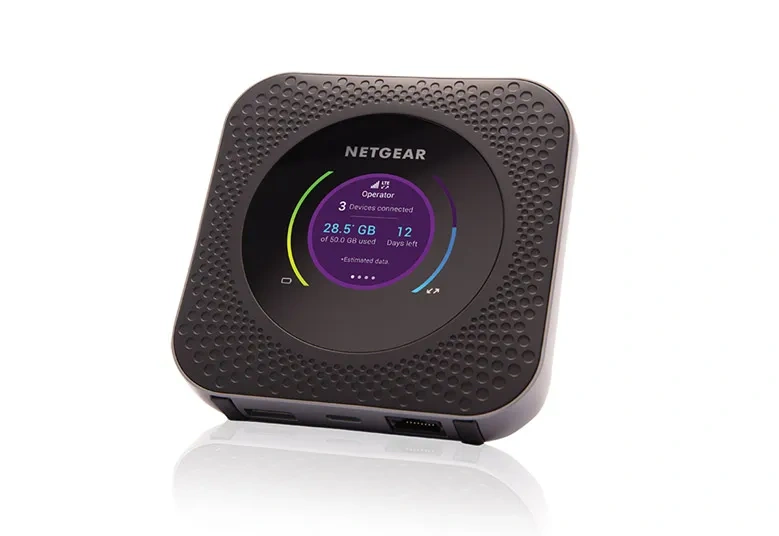

# Portable Equipment -- Briefcase & Backpack

## USB-C Ethernet Adapters

### `anker-dongle` -- Anker USB-C to Gigabit Ethernet

- Chip: Realtek RTL8153 (VID 0x0bda / PID 0x8153)
- Firmware version: 30.00
- USB speed: USB 3.1 Gen 1 (5 Gb/s)
- Ethernet: 1 Gbps
- Serial: 000001
- MAC: 00:e0:4c:00:00:93
- Power draw: 288 mA
- Interface: en7 on michael-pro (archived); en7 on michael-air (current)
- Note: USB-C plug and RJ45 plug both have worn latches; cable and dongle taped together

### `belkin-dongle` -- Belkin USB-C to Gigabit Ethernet

- Chip: Realtek RTL8153 (VID 0x0bda / PID 0x8153)
- Firmware version: 31.00
- USB speed: USB 3.1 Gen 1 (5 Gb/s)
- Ethernet: 1 Gbps
- Serial: 0013000001
- MAC: 80:69:1a:8d:ea:8a
- Power draw: 112 mA
- Interface: en13 on michael-pro (archived); TBD on michael-air (when connected)
- macOS: built-in Realtek driver; no system extension needed
- Setup: Network → Add Service on first use per machine

## 5G Mobile Hotspot

### `nighthawk-m1` - Netgear Nighthawk M1 (MR1100) / AT&T 4G LTE - **NOT 5G**

[Product page](https://www.netgear.com/outlet/imperfect-box/hotspots/mr1100/)

- Model: Nighthawk M1 (GUI version MR1100-100NAS_04.01.80.00)
- Network: 4G LTE only (no 5G capability)
- Max Speed: Up to 1 Gbps combined (Category 16 LTE Advanced Pro with 4-band carrier aggregation)
- Hardware Version: 1.0
- Firmware Version: NTG9X50C_12.06.11.00
- Bootloader: NTG9X50C_12.06.11.00
- PRI Version: 05.03
- Build Date: 2020-01-24
- Dimensions: 105.5 (L) × 105.5 (W) × 20.35 (H) mm
- Weight: 240 g (with battery)
- Battery: 5040 mAh; up to 11 hours continuous usage
- WiFi: Dual-band 802.11ac (2.4 GHz b/g/n and 5 GHz a/n/ac)
- LTE Bands: 1, 2, 3, 4, 5, 7, 12, 14, 29, 30, 66
- 3G Bands: 1, 2, 5
- IMEI: 015240000553847
- IMEI SV: 13
- Serial (FSN): 5K1511N850711
- MAC Address: 44:A5:6E:E9:59:29
- SIM Serial: 890141033345577095
- Service Number: +1 (984) 381-5800
- Status: Device deactivated 2026-10-12 in Cheboygan MI AT&T Store
- Notes: Marginal performance in Crystal River area (used 2+ years). Was limping along on LTE before deactivation.
- eBay Listing: [Listed on eBay 2026-10-16](nighthawk-m1-ebay-listing.md)
- Credentials: Stored in 1Password as "wolfden-hotspot - Nighthawk/Netgear - 192.168.1.1"

## WiFi Extender

### `cheapo-extender` -- Generic USB WiFi Repeater

- Model: Amazon B0DCBYCHR7
- Purchased: 2025-08-10 for $18
- IP: 192.168.11.1 (management)
- Role: Portable campground WiFi signal extension
- Docs: [cheapo_extender.md](cheapo_extender.md)

## Ethernet Cables

| Name                 | Description                        | Verified good |
|----------------------|------------------------------------|---------------|
| `cable-black-10ft`   | Black Cat6, 10 ft, indoor RV       | Yes           |
| `cable-green-3ft-a`  | Green Cat6, 3 ft, indoor RV        | Yes           |
| `cable-green-3ft-b`  | Green Cat6, 3 ft, indoor RV        | Yes           |
| `cable-outdoor-50ft` | Cat6, 50 ft, exterior run, RV side | Yes           |

Verified by: michael-pro → anker-dongle → [cable] → running-wolf-hotspot → internet (ping 1.1.1.1)
To re-verify on michael-air: michael-air → [dongle] → [cable] → running-wolf-hotspot → internet
